# BrutalPrinceJS

Play the game at [https://brutalprince.com/](https://brutalprince.com/).

Full gameplay video: [https://youtu.be/cdG6oBzTbxA](https://youtu.be/cdG6oBzTbxA)

Forked from [oklemenz/PrinceJS](https://github.com/oklemenz/PrinceJS). Thanks to Oliver Klemenz and the PrinceJS contributors for the original game! Everything added in this fork is pure AI vibecoding.

## Gameplay screenshots

Captured from the real game with sound muted. Combat scenes are staged with the repository's browser playtest helpers so the actions and their effects are easy to see; they use the actual weapons, animations, collision physics and level scenery.

### Twin torches: burn everyone within reach

Hold `CTRL` / `F` with `1` selected to spin both torches. These guards are already out of the fight, but their burning bodies keep running before collapsing.

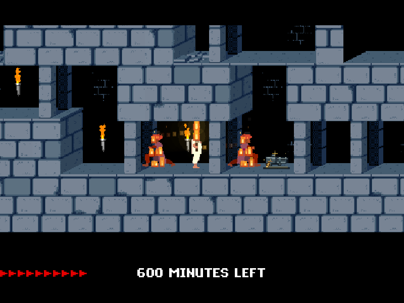

### Molotov: throw, ignite, or drop from a ledge

Charge and release a throw to send a burning bottle toward the guards. Its impact leaves real ground fire that ignites them.

| Bottle in flight                                                                             | Guards burning in the ground fire                                                                                 |
| -------------------------------------------------------------------------------------------- | ----------------------------------------------------------------------------------------------------------------- |
| 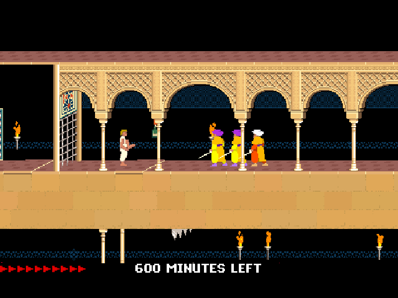 | 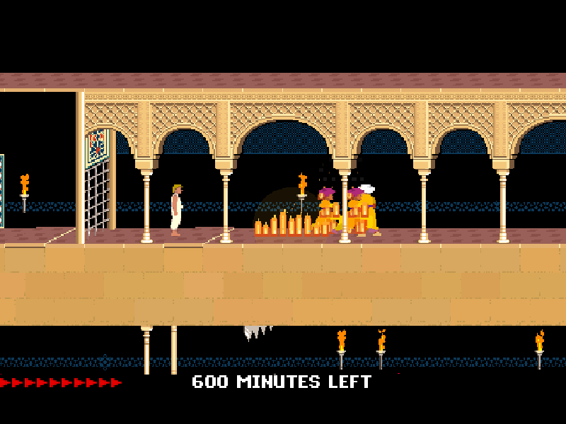 |

While hanging, press `CTRL` / `F` to light and drop the bottle below without letting go of the ledge.

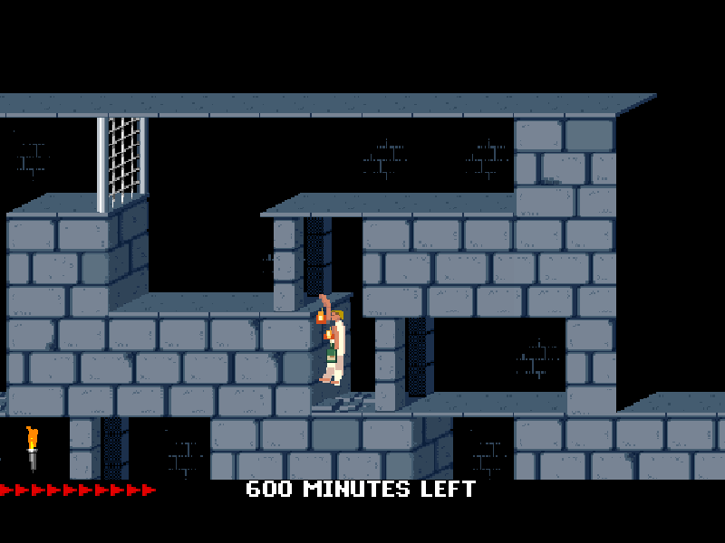

### Minigun: rapid fire and varied deaths

Hold the trigger to cut through a crowd. Minigun kills cycle through tumbling face hits, torn arms, waist splits, severed heads and leg collapses; spent casings collect on the floor in ten independent depth layers, five behind the Prince and five in front of him.

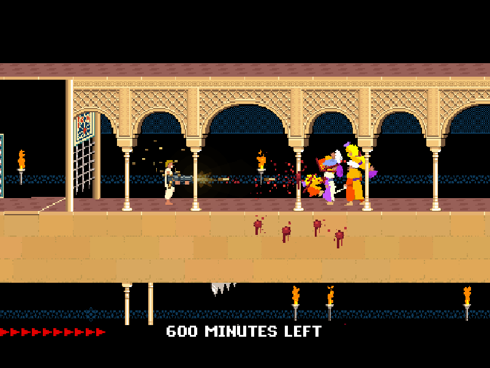

### Rocket launcher: explosive dismemberment

Rockets accelerate into their targets and scatter body parts through the surrounding room. Fragments collide with the scenery and leave blood behind.

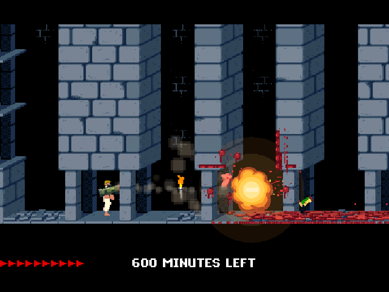

### Rocket launcher: break the exit and keep going

A rocket can shatter the next-level exit into flying fragments. The damaged doorway stays open and usable. Arrival doors remain protected.

| Exit destruction                                                                                                    | The permanent, usable breach                                                                                          |
| ------------------------------------------------------------------------------------------------------------------- | --------------------------------------------------------------------------------------------------------------------- |
| 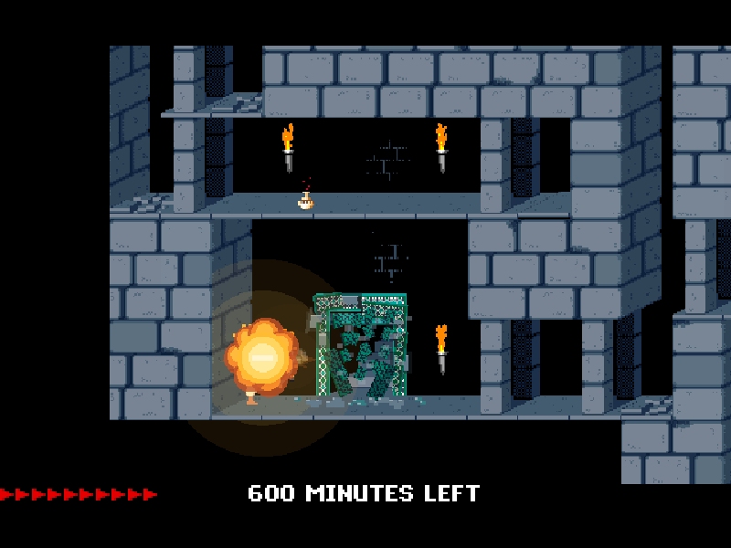 | 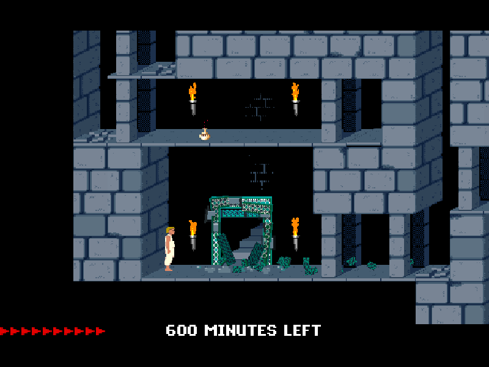 |

### Whip: strike or pull an enemy off a ledge

`X` can finish a weakened guard with a direct lash, or catch an enemy above you by the ankle and pull them into a real gap. A short fall costs a life and leaves them recovering; longer drops can be fatal.

| A lethal direct strike                                                                     | An ankle caught above a gap                                                                                          |
| ------------------------------------------------------------------------------------------ | -------------------------------------------------------------------------------------------------------------------- |
| 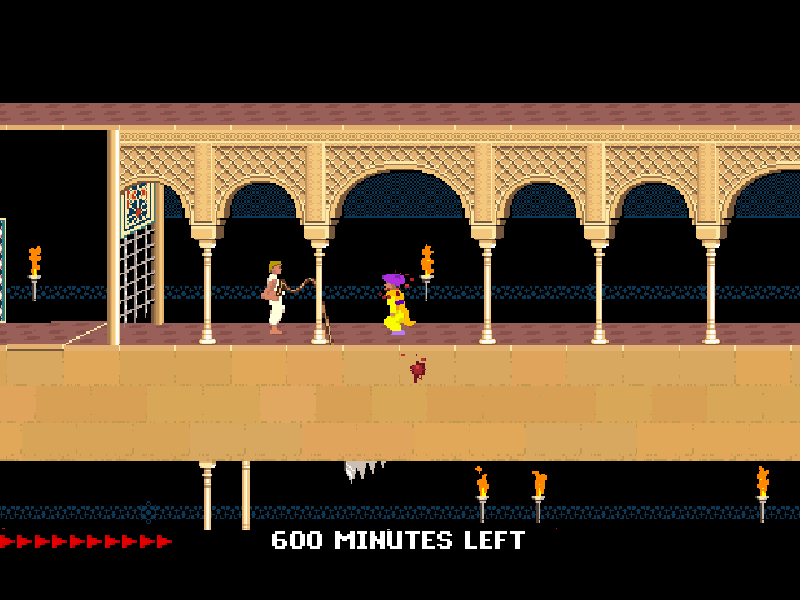 | 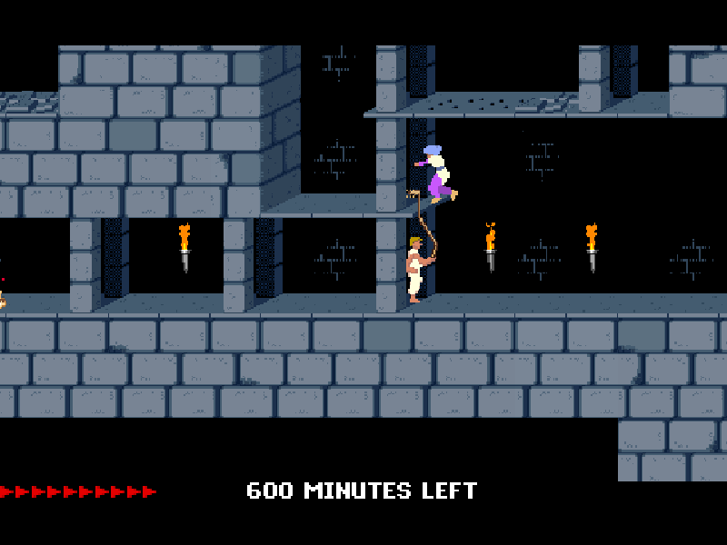 |

### Roundhouse kick: make some room

`C` launches nearby guards and can start a body-to-body knockdown. The blood is cosmetic: the kick itself does not remove HP. Guards recover after landing, while traps and fatal drops keep their normal effects.

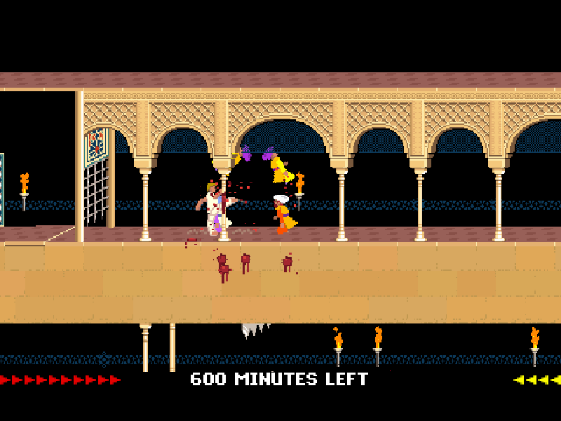

### Jetpack: take the upper route

From level 12, collect the jetpack, equip it with `J` and fly with the arrow keys. Hover between platforms or break loose floor slabs from below.

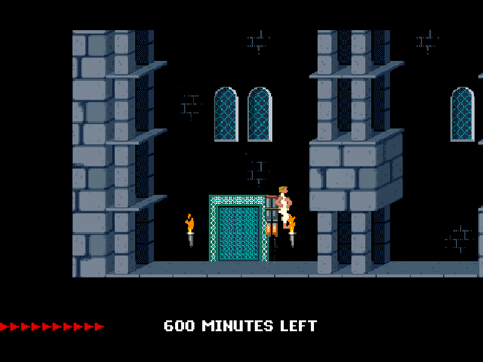

### The aftermath stays

Blood stains, fallen body parts and brass remain throughout the level, even after leaving and revisiting the room. Restarting or changing levels clears them.

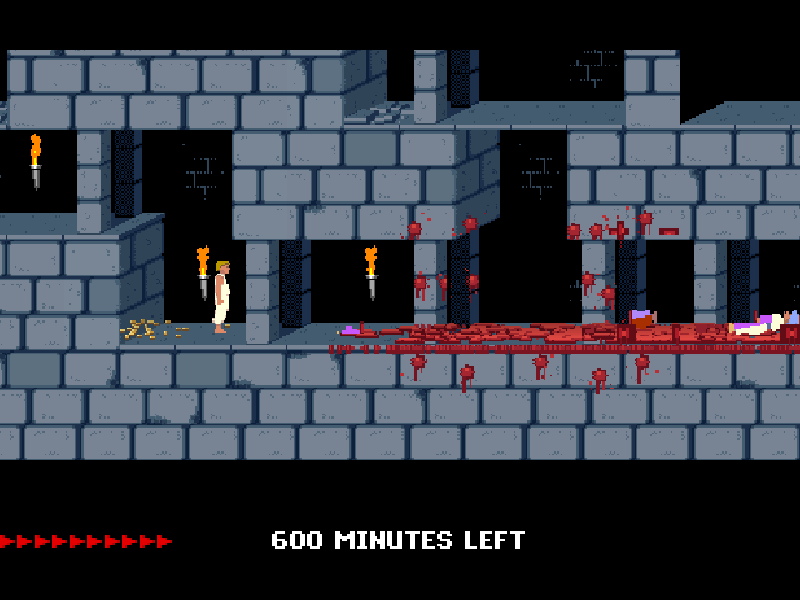

## Play

For isolated local previews, run `npm run preview` and open [the preview launcher](http://127.0.0.1:8090/dev/preview/).
Category buttons show the Prince walking through increasingly tall casing piles, the real tutorial windows, the
full ending animation, and the dripping epilogue title. Replay, pause and the ending timeline make each moment easy
to inspect; **Open larger** gives the selected preview the full browser area. This static server
binds only to localhost, never loads `.env` or MongoDB, and has no statistics API. Its separate engine instance does
not start campaign levels, load a statistics recorder, change saved settings or play sound.

Use Node.js 24, run `npm install` and `npm start`, then open the local address printed by the server (usually `http://localhost:8080`).
The Koa server serves both the game and `/api/v2/gameplay-statistics`. The game remains playable when the statistics database is unavailable.

To enable local MongoDB storage, copy `.env.example` to `.env`, replace the password placeholder in that local file,
and run `npm run start:local`. `.env` is ignored by Git and never served to browsers. On Heroku, set the existing
`mongoconnectionurl` config var; `PORT` is provided by Heroku and the `Procfile` starts the web server. The database
defaults to `brutalprince` with collection `brutalprince`; override the database with `MONGODB_DATABASE` if needed.
`MONGODB_URI` is also supported as a fallback.

### Gameplay statistics

Open the top-right settings menu (or press `Esc`) and turn off **Send gameplay statistics** to stop collection and
transmission immediately. The preference is saved on this device. Statistics include deaths and their causes, guard/trap
damage, level attempts and active play, plus weapon, room, pickup and tutorial counts. Each page gets a random `clientId`;
MongoDB keeps one cumulative summary per client, map revision, level and UTC day. Enemy kills are counts by cause/weapon,
and repeated Prince damage/deaths share source/location counters. Retries cannot double-count. Requests run in the background
in batches, normally three seconds after the last event. Failures show no error in the game. See
[statistics setup and queries](docs/statistics.md) and the [ADR](dev/adr/2016-10-11-gameplay-statistics-api-and-mongodb.md).

Run `npm test` for automated checks. To test actual MongoDB persistence using your ignored local `.env`, run
`npm run test:mongodb`. Tests use the dedicated `testbrutalprince` database (override with `MONGODB_TEST_DATABASE`).
Each run creates and removes only its own `test_gameplay_events_…` collection; it never wipes
the production collection. These network tests are opt-in and do not run during `npm test`.

Game logic runs at 60 fixed steps per second independently of the display refresh rate, with bounded catch-up when
the browser renders at 30 fps. Weapons, effects, camera movement and cinematic animations use this same logic step;
120/144 Hz displays therefore keep the same gameplay speed as 60 Hz. Timing regression tests cover 30–240 fps and pause/stall handling.

To view statistics locally, open `/statistics` on the local Koa server. For a sample preview, run
`npm run statistics:reset` and then `npm run statistics:preview`, and open `http://127.0.0.1:8081/statistics`.
Reset fills only `testbrutalprince.test_dashboard_events` with random observations through the API. Use
`statistics:seed` to add samples or `statistics:wipe` to empty that collection. The dashboard and reporting API are public,
including on Heroku: open `/statistics` on the deployed game. See [preview details](docs/statistics.md#statistics-page-and-local-preview).

Prince deaths and enemy kills have separate daily charts. Alongside the two absolute danger rankings, two more show
deaths per 100 unique clients who started each level and map revision. Select a guard, dangerous place or recent death
to open its animated room with the source highlighted. This silent preview has no Prince or damage and cannot alter
your game, saved settings or gameplay statistics. Old map revisions are identified when only the current layout is available.

## Controls

| Key          | Action                                                       |
| ------------ | ------------------------------------------------------------ |
| Arrow keys   | Move, jump, crouch and climb; fly with the jetpack.          |
| `SHIFT`      | Walk, grab ledges and drink potions.                         |
| `1`–`4`      | Select twin torches, molotov, minigun or rocket launcher.    |
| `CTRL` / `F` | Use the selected weapon; release to throw a charged molotov. |
| `X` / `C`    | Whip / roundhouse kick.                                      |
| `J` / `ESC`  | Toggle the jetpack / open settings and controls.             |

Torches start in level 1; collect the molotov and minigun there, the whip and rocket launcher in level 2, and the jetpack in level 12. Equipment carries forward. The kick is always available. Rockets can destroy walls and exits without blocking progress.

The game also has persistent blood and casings, tougher crowds, healing and maximum-health potions, a wider camera, contextual tutorials, and optional touch controls. Jaffar has 50 life and stands alone on his continuous upper platform, including its extensions into neighboring rooms; enemies remain on separate platforms and lower floors. Large enemy health totals use a compact current/maximum counter. The intro adds a bloody **Brutal** above the original title. The final story page names the hero **BRUTAL PRINCE OF PERSIA**, with blood dripping from the added word.

The victory scene has its own animated finale: a bloodied Prince brings Jaffar's recognizable corpse and a minigun, puts the body down, then kicks its head off through the window, shattering the glass. The head disappears through the opening and behind the wall. He raises the minigun and dances while firing upward; the Princess draws an AK in each hand and joins him. Their shots crack pillars and knock chunks loose. The pillars stay upright while a heavy piece breaks out of the ceiling arch and falls onto Jaffar's body with a burst of blood, leaving a matching hole overhead that reveals the preserved inner arch. The original epilogue follows automatically, and the usual cutscene skip still works. These cinematic weapons do not change the playable inventory or combat controls.

For a muted local preview, open `tests/finale-browser.html` on the development server. It runs the actual transition from level 14 and provides replay, pause and key animation moments for inspection.

Tutorial screens are larger story pages with the original red-and-gold mosaic, blue checker background, large white pixel serif lettering, and illustrations of the Prince and his equipment. Confirmation keys stay visible when the reading area scrolls on a small screen. Exit-door tutorials in levels 2 and 3 teach selecting the rocket launcher with `4` and blasting the doors with `Ctrl` / `F`. Collecting the jetpack in level 12 explains `J` to equip or remove it and the arrow keys to fly.

See [the project rules](ruleset.md) and [tutorial documentation](docs/tutorials.md) for details.
